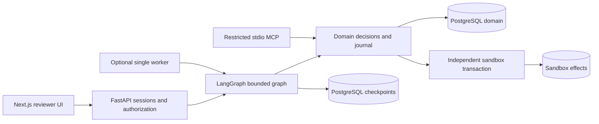
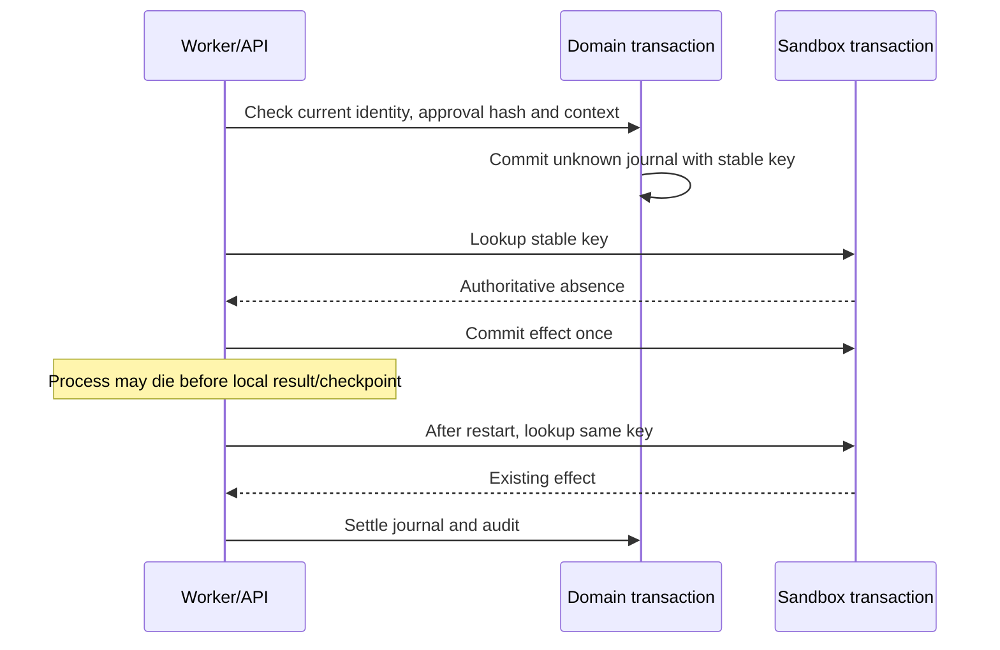

# Architecture and decisions

The trust boundary is the server identity plus the current PostgreSQL domain row.
Model output, retrieved text, MCP arguments and LangGraph checkpoints cannot grant
approval. Evidence uses a strict schema; policy abstains on missing or contradictory
fields. The action digest includes schema version, case ID, context version and
the exact action payload. Reviewer edits change that digest. Context replacement
invalidates the proposal and decision. Row locks serialize competing decisions.

Domain, checkpoints and external-effect simulation are separate tables/schemas,
but share one PostgreSQL host for this demo. This is not failure-domain isolation.
The MCP transport is independently tested; graph nodes currently call domain code
directly. Each repository has its own database and synthetic fixtures. There is
no cross-project database access and no Commerce dependency.

```mermaid
stateDiagram-v2
  [*] --> open
  open --> review: deterministic proposal
  review --> review: edit and rehash
  review --> approved: matching human decision
  review --> rejected: reject
  approved --> uncertain: persist intent before effect
  uncertain --> executed: authoritative lookup or effect verified
  approved --> open: context replacement invalidates approval
  review --> open: context replacement
  open --> cancelled
  review --> cancelled
  approved --> cancelled
  uncertain --> cancelled: preserve uncertainty; prohibit new effect
```

## ADR: domain journal over checkpoint-based effect inference

Alternative: treat a completed LangGraph node as proof of an external effect.
Rejected because a process can die after provider commit and before checkpoint.
Decision: store unknown intent first, use stable provider idempotency and reconcile
before retry. Consequence: uncertainty is an explicit state and the provider must
offer authoritative lookup. If lookup is unavailable, no blind retry occurs.

## ADR: deterministic policy before model integration

Alternative: let a model choose tools and approve its own output. Rejected because
permission and truth are domain concerns. The initial policy consumes structured
evidence only and ignores instructions in retrieved prose. This intentionally
simple baseline supports regression/failure experiments. It does not demonstrate
real-model reasoning quality or broad prompt-injection resistance.

## Known limits

- No real LLM provider execution or subjective human evaluation yet.
- Invocation budgets reset at resume; durable lifetime quotas are still needed
  before enabling autonomous provider usage. Elapsed-time checks are cooperative.
- MCP uses a trusted local launcher identity, not remotely exposed OAuth.
- No public deployment, HA, offsite backup or hosted telemetry.
- The browser shows at most the latest 50 cases; cursor pagination is pending.
- SQL migrations are additive and rerunnable, but a migration-ledger upgrade
  protocol and production rollback rehearsal remain future hardening.
- Synthetic sandbox actions only flag/close a case; no money is transferred.
- No independent review or people-management claim is made by these individual PRs.
